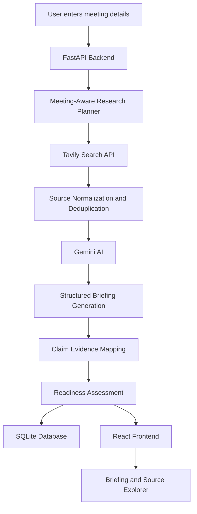

# BrieflyAI

### Intelligence, without the noise.

**BrieflyAI is an AI-powered, source-backed pre-meeting intelligence platform that helps professionals walk into meetings informed, prepared, and confident.**

Instead of spending hours searching through company announcements, industry developments, leadership updates, and news articles, users can generate structured meeting briefings tailored to their specific objectives.

BrieflyAI combines real-time web research with AI-powered synthesis and evidence mapping to turn scattered information into actionable meeting intelligence.

---

## The Problem

Preparing for an important meeting often involves researching multiple sources, identifying relevant developments, understanding key decision-makers, and preparing meaningful questions.

This process is time-consuming and fragmented.

Traditional AI-generated summaries also introduce another problem: information without reliable supporting evidence.

## Our Solution

BrieflyAI automates the research and preparation process.

Users provide a company or individual's name, meeting details, and their objective. The platform researches relevant information, synthesizes the findings, maps claims to supporting sources, and generates a structured briefing.

The goal is simple: **less time researching, more time making informed decisions.**

---

## Key Features

### 1. Meeting-Aware Research
- Researches companies and individuals.
- Adapts research queries to the meeting type and objective.
- Uses a date-relative 30-day research window ending on the meeting date.
- Retrieves relevant information through Tavily Search.

### 2. AI-Powered Briefings
Generates structured meeting intelligence containing:
- Executive summary.
- Recent developments.
- Key people.
- Potential opportunities.
- Risks and considerations.
- Tailored meeting questions.

### 3. Evidence-Based Claim Assessment
- Maps briefing claims to retrieved sources.
- Provides claim-level evidence references.
- Identifies verified, partially verified, unverified, conflicting, and outdated claims.
- Makes supporting evidence accessible through the interface.

### 4. Meeting Readiness Assessment
Provides an explainable readiness score based on briefing completeness.

The score measures preparation coverage, not the probability of meeting success or the absolute truth of every claim.

### 5. Research History
- Stores generated briefings in SQLite.
- Allows users to revisit previous research.
- Provides access to previously retrieved sources and briefing details.

### 6. Source Explorer
Explore the research behind a briefing, including source titles, domains, publication dates when available, and supporting content.

---

## How It Works



### Research Pipeline

1. The user submits meeting information.
2. The backend creates research queries based on the meeting context.
3. Tavily retrieves relevant web sources.
4. Retrieved sources are normalized and deduplicated.
5. Gemini synthesizes the available research into structured JSON.
6. Claims are mapped to supporting source references.
7. The readiness assessment is calculated.
8. The completed briefing is stored and returned to the frontend.

---

## Technology Stack

| Technology | Purpose |
|---|---|
| React | Frontend user interface |
| TypeScript | Type-safe frontend development |
| Vite | Frontend development and build tooling |
| CSS | Interface styling and responsive layouts |
| Python | Backend development |
| FastAPI | REST API and backend orchestration |
| Pydantic | Configuration and data validation |
| Gemini API | AI-powered synthesis and structured briefing generation |
| Tavily Search API | Web research and source retrieval |
| SQLite | Persistent briefing history |
| HTTPX | Asynchronous API communication |

---

## Project Structure

```text
brieflyai/
│
├── backend/
│   ├── main.py
│   ├── config.py
│   ├── database.py
│   ├── models.py
│   │
│   ├── routes/
│   │   └── meetings.py
│   │
│   └── services/
│       ├── gemini_service.py
│       ├── tavily_service.py
│       ├── research_agent.py
│       ├── verification_service.py
│       └── readiness_service.py
│
├── frontend/
│   ├── index.html
│   └── src/
│       ├── main.tsx
│       ├── pages/
│       │   └── App.tsx
│       ├── services/
│       │   └── api.ts
│       ├── types/
│       │   └── index.ts
│       └── style.css
│
├── tests/
│   └── test_core.py
│
├── .env.example
├── .gitignore
├── package.json
├── package-lock.json
├── README.md
└── vite.config.ts
```

---

## Getting Started

Follow these instructions to run BrieflyAI locally.

### Prerequisites

- Python 3.11 or later.
- Node.js and npm.
- A Tavily API key.
- A Google Gemini API key.

### 1. Clone the Repository

```bash
git clone https://github.com/Jinna-hash/brieflyai
cd brieflyai
```

### 2. Set Up the Backend

Create a Python virtual environment:

```bash
python -m venv .venv
```

Activate it.

**Windows PowerShell:**

```powershell
.venv\Scripts\Activate.ps1
```

**macOS/Linux:**

```bash
source .venv/bin/activate
```

Install dependencies:

```bash
pip install -r backend/requirements.txt
```

### 3. Configure Environment Variables

Create a `.env` file in the project root using `.env.example` as a template.

```env
TAVILY_API_KEY=your_tavily_api_key

GEMINI_API_KEY=your_gemini_api_key
GEMINI_MODEL=gemini-3.6-flash

DATABASE_URL=sqlite:///./brieflyai.db

RESEARCH_MAX_RESULTS=6
REQUEST_TIMEOUT=120
```

Replace the placeholder values with your own API credentials.

**Important:** Never commit your `.env` file or expose API keys publicly.

### 4. Start the Backend

From the project root:

```bash
uvicorn backend.main:app --reload --port 8000
```

The backend should be available at:

```text
http://localhost:8000
```

API health check:

```text
http://localhost:8000/api/health
```

Interactive API documentation:

```text
http://localhost:8000/docs
```

### 5. Start the Frontend

Open a second terminal.

Install dependencies:

```bash
npm install
```

Start the development server:

```bash
npm run dev
```

Open:

```text
http://localhost:5173
```

BrieflyAI should now be running locally.

---

## API Endpoints

| Method | Endpoint | Description |
|---|---|---|
| GET | `/api/health` | Checks backend and integration configuration |
| POST | `/api/briefings` | Generates a new meeting briefing |
| GET | `/api/briefings` | Retrieves briefing history |
| GET | `/api/briefings/{id}` | Retrieves a specific briefing |

### Example Request

```json
{
  "subject": "Tesla",
  "subject_kind": "Company",
  "meeting_date": "2026-11-12",
  "meeting_time": "10:00",
  "timezone": "Asia/Kolkata",
  "meeting_type": "Partnership discussion",
  "objective": "Explore a potential business partnership"
}
```

---

## Testing

Run backend tests:

```bash
python -m pytest -q
```

Build the frontend:

```bash
npm run build
```

---

## Current Limitations

- Briefing generation currently depends on external Tavily and Gemini API availability.
- The research pipeline operates on retrieved sources and cannot guarantee that every relevant development is discovered.
- Publication dates are displayed when available from retrieved sources.
- Claim assessments are AI-assisted evidence evaluations, not independent guarantees of factual accuracy.
- Briefing generation currently uses a synchronous request-response workflow.
- User authentication and multi-user account management are not yet implemented.

---

## Roadmap

Planned improvements include:

- User registration and secure authentication.
- Personalized briefing history.
- Google sign-in.
- Real-time research progress updates.
- PDF briefing export.
- Calendar integrations.
- Improved cross-source contradiction detection.
- Deeper source extraction and evidence analysis.

---

## Screenshots

Screenshots of the actual application will be added here.

---

## Project Vision

BrieflyAI aims to make meeting preparation faster, more structured, and more reliable.

By combining real-world research with evidence-aware AI synthesis, it helps transform information overload into useful intelligence.

**BrieflyAI. Walk into every meeting informed.**